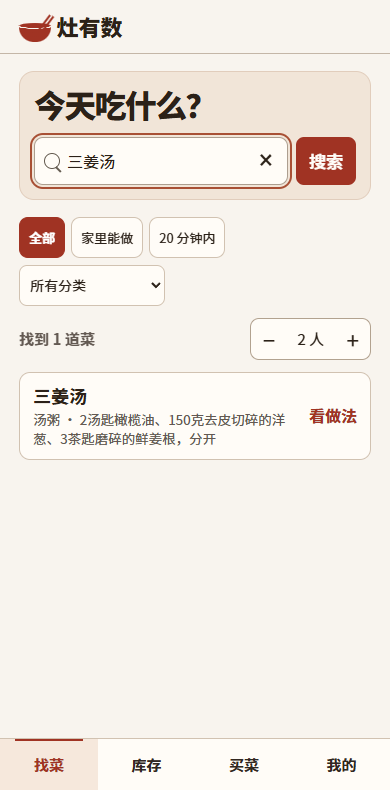

# 灶有数 · Zaoyoushu Kitchen

[简体中文](#简体中文) · [English](#english) · [下载手机版 / Download](https://github.com/zhetao068-lgtm/zaoyoushu-kitchen/releases/latest) · [项目赞助](#项目赞助) / [Support](#support)

## 简体中文

**灶有数**是面向手机的家常菜工具。它帮你从手头食材出发找到菜谱、核对用量、列买菜清单，再跟着步骤做。

从 [发行版](https://github.com/zhetao068-lgtm/zaoyoushu-kitchen/releases/latest) 下载 ZIP，解压后用浏览器打开其中的 `index.html`。可以搜「西红柿炒鸡蛋」「鸡蛋和土豆」或「清蒸」。库存里可一次录入「鸡蛋 4 个 土豆半斤」。从同一个浏览器和入口重新打开时，可以继续使用已存的库存和做菜记录。

- **先找菜。** 按菜名、食材或做法搜 **1,286 道菜谱**，查看用量、步骤和出处。
- **再看缺什么。** 124 道定量家常菜支持换算人数、检查库存缺口和合并买菜清单。
- **保存自己的做法。** 网页无需账号，库存、菜单和个人做菜记录保存在当前浏览器。

菜谱经过文字整理与校对。引用的菜谱保留出处、署名和许可。 [菜谱来源与许可](DATA-SOURCES.md)

### 项目赞助

灶有数采用自愿赞助。手机版、菜谱库与技术论文均可免费访问。赞助用于支持菜谱来源校对、手机端测试、无障碍改进和日常维护。收款入口待开通。

### 技术论文

- [在 1,286 道菜谱上优化中文组合搜索](papers/01-browser-recipe-search.md)
- [无账号菜谱网页的本机存储与发布包校验](papers/02-local-pantry-security.md)
- [论文目录与复现说明](papers/README.md)

## English

**Zaoyoushu Kitchen** is a mobile-first recipe finder and pantry planner for Chinese home cooking. Start with the ingredients you have, check what the recipe calls for, assemble a shopping list, and cook one step at a time.

Download the ZIP from the [latest release](https://github.com/zhetao068-lgtm/zaoyoushu-kitchen/releases/latest), extract it, and open `index.html` in your browser. The current recipe collection and search interface are in Chinese. Try 「西红柿炒鸡蛋」 for tomato and eggs, 「鸡蛋和土豆」 for eggs and potatoes, or 「清蒸」 for steaming.

- **Find a recipe.** Search **1,286 recipes** by dish, ingredients, or cooking method. Open a result to read its quantities, instructions, and source.
- **Check what's missing.** For 124 recipes with structured quantities, scale servings, compare against your pantry, and combine the missing ingredients into a shopping list.
- **Keep your own cooking notes.** No account is required. Pantry entries, selected dishes, and personal notes stay in the current browser. Reopen the same entry point to access them.

The standalone page bundles its recipe data, styles, and scripts. Imported recipes carry their original attribution and licensing information. [Data sources and licenses](DATA-SOURCES.md)

### Support

Zaoyoushu Kitchen welcomes voluntary support for recipe attribution, mobile testing, accessibility improvements, and maintenance. The app, recipe collection, and engineering papers are free to access. The payment link is pending.

### Engineering papers

- [Optimizing multi-term Chinese search across 1,286 recipes](papers/01-browser-recipe-search.md)
- [Browser-local pantry storage and release verification](papers/02-local-pantry-security.md)
- [Paper index and reproduction instructions](papers/README.md)
